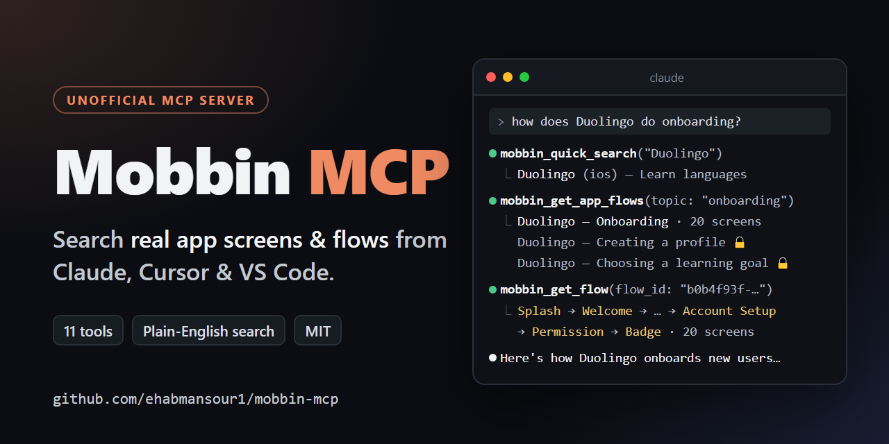
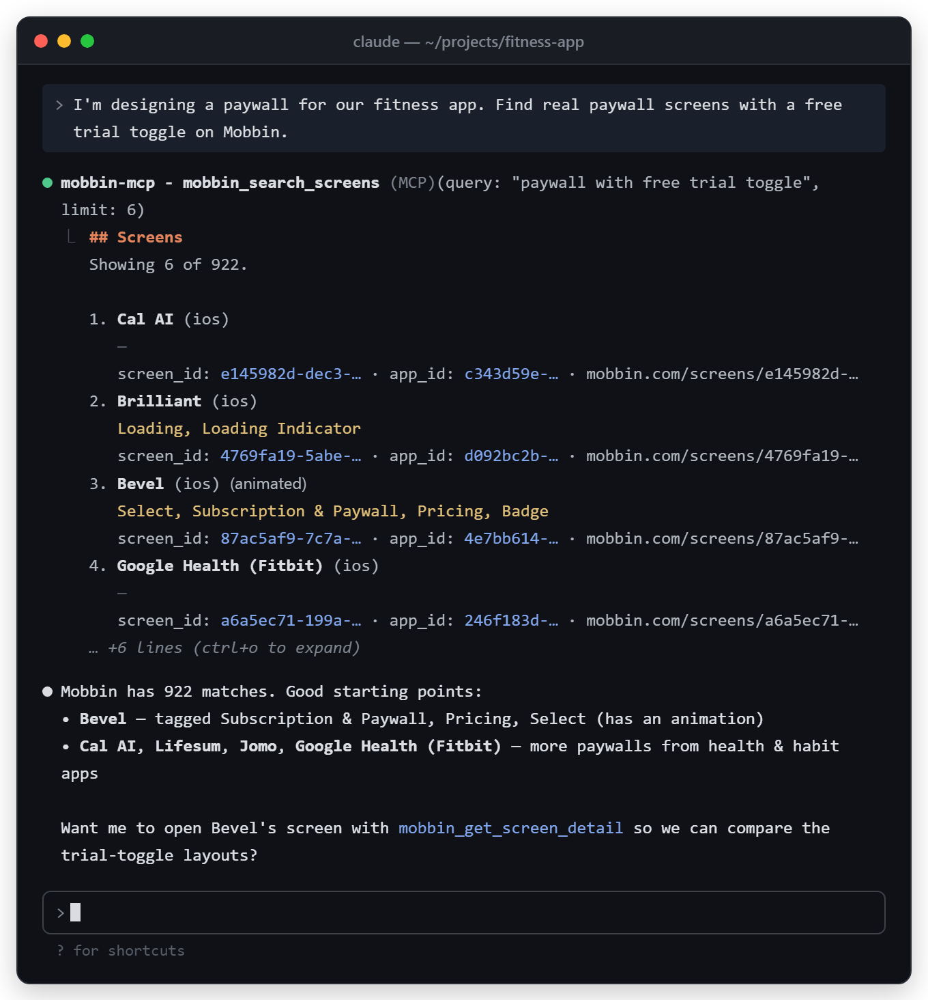
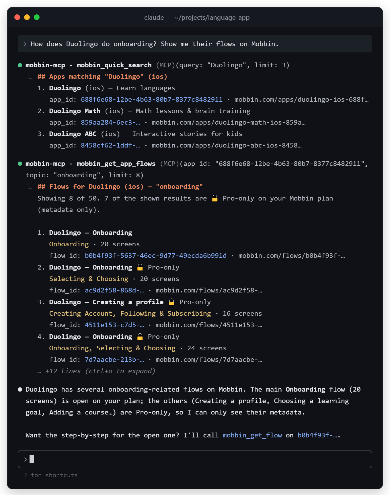
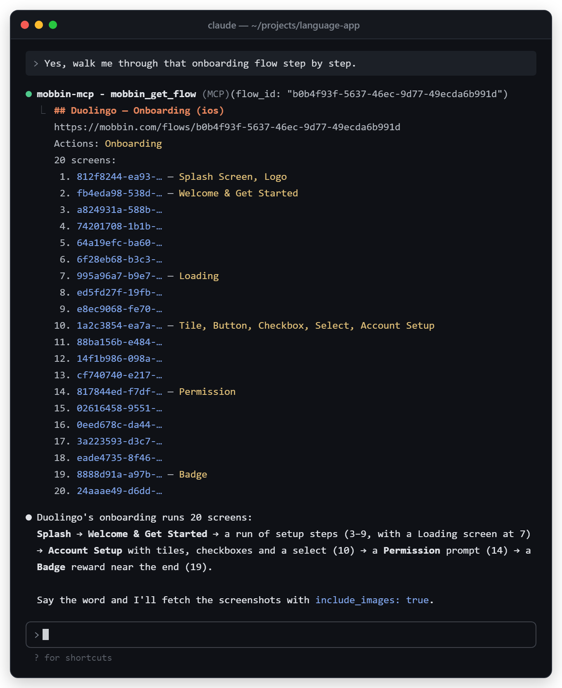
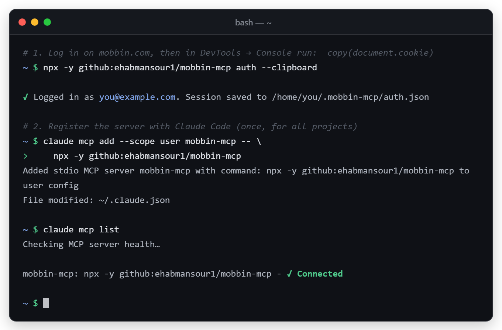
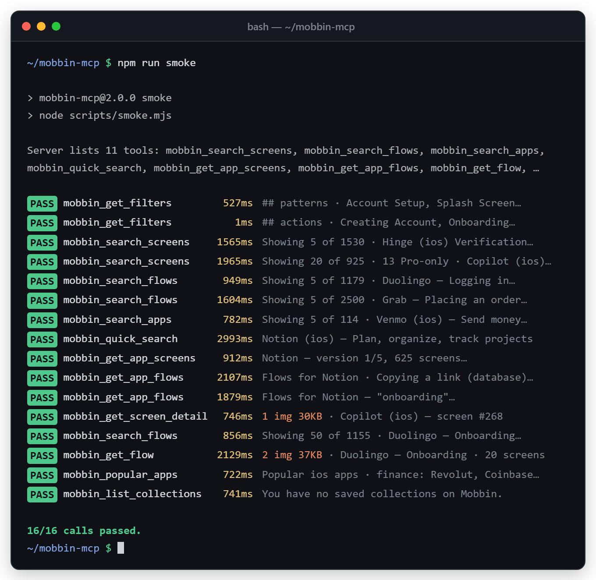
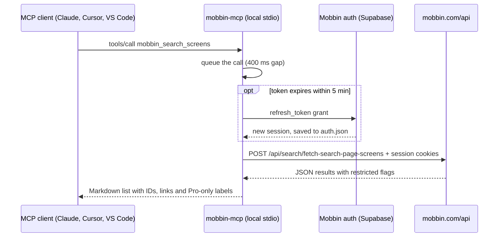

# Mobbin MCP Server: search Mobbin UI screens & user flows from Claude, Cursor and VS Code

[](LICENSE)
[](https://nodejs.org/)
[](https://modelcontextprotocol.io/)
[](https://github.com/ehabmansour1/mobbin-mcp/actions/workflows/ci.yml)
[](https://github.com/ehabmansour1/mobbin-mcp/stargazers)

**Mobbin MCP** is an unofficial, open-source **MCP server** (Model Context Protocol) for [Mobbin](https://mobbin.com).
It lets your AI assistant search Mobbin's library of real app **screens**, **user flows** and UI patterns
for **UI design inspiration**, right inside **Claude Code**, Claude Desktop, **Cursor**, VS Code (GitHub Copilot),
Windsurf, Cline, Codex CLI, Gemini CLI and any other MCP client. Ask in plain English ("show me paywalls with a
free-trial toggle"), or filter by Mobbin's own taxonomy of screen patterns, UI elements and flow actions. You can
also open one app's screens and flows and pull screenshots into the chat.

<p align="center">
  
</p>

> **Mobbin now has an official MCP server**, and it is the better choice for anything important:
>
> ```bash
> claude mcp add mobbin --transport http https://api.mobbin.com/mcp
> ```
>
> This project is a community alternative. It talks to Mobbin's **undocumented internal web endpoints**,
> which can change without notice. See [Official Mobbin MCP vs this project](#official-mobbin-mcp-vs-this-project).

Website: <https://ehabmansour1.github.io/mobbin-mcp/>

## Table of contents

- [Features](#features)
- [Demo](#demo)
- [Quick start](#quick-start)
- [How to connect (per client)](#how-to-connect-per-client)
- [Login / authentication](#login--authentication)
- [Tools reference](#tools-reference)
- [Example prompts](#example-prompts)
- [Free vs Pro Mobbin plans](#free-vs-pro-mobbin-plans)
- [Troubleshooting](#troubleshooting)
- [How it works](#how-it-works)
- [Official Mobbin MCP vs this project](#official-mobbin-mcp-vs-this-project)
- [FAQ](#faq)
- [Development](#development)
- [Disclaimer](#disclaimer)
- [Credits](#credits)
- [License](#license)

## Features

- **11 MCP tools** covering screen search, flow search, app browsing, per-app screens and flows, flow details,
  screenshots, popular apps, your collections and Mobbin's filter taxonomy.
- **Natural-language search** through Mobbin's AI search: `"dark mode settings with toggles"`, `"food delivery checkout"`.
- **Taxonomy filters**: screen patterns (Signup, Paywall…), UI elements (Bottom Sheet, Card…), flow actions
  (Onboarding, Logging In…), app categories, OCR text inside screenshots, and "has animation".
- **iOS, Android and web**: every search tool takes a `platform`.
- **Screenshots the model can see**: `mobbin_get_screen_detail` and `mobbin_get_flow` return images, not just links.
- **Uses your own Mobbin account.** Log in once from the terminal and the session refreshes itself. Requests go only
  to `mobbin.com`, `bytescale.mobbin.com` (screenshots) and Mobbin's Supabase auth host
  (`ujasntkfphywizsdaapi.supabase.co`, for token refresh).
- **Free-plan aware**: results Mobbin restricts on your plan are labelled `🔒 Pro-only`. The paywall is **not** bypassed.
- **Gentle on Mobbin**: requests are queued one at a time with a 400 ms gap. Rate-limit and captcha responses come
  back as plain messages and are not retried.
- **Self-check**: `npm run smoke` calls every tool against the live API and prints PASS/FAIL. Use it to spot
  endpoint changes.

## Demo

Tool output is real (captured 2026-11-04 on a free Mobbin plan) and trimmed for length; the assistant's replies are
illustrative. The login image uses a placeholder email and home path, and the smoke-test previews are condensed.

<p align="center">
  
  <br><em>Searching Mobbin for paywall screens from Claude Code with <code>mobbin_search_screens</code>.</em>
</p>

<p align="center">
  
  <br><em>"How does this app do onboarding?": <code>mobbin_quick_search</code> → <code>mobbin_get_app_flows</code> with <code>topic: "onboarding"</code>.</em>
</p>

<p align="center">
  
  <br><em>One flow, screen by screen, with Mobbin's pattern tags (<code>mobbin_get_flow</code>).</em>
</p>

<p align="center">
  
  <br><em>One-time login, then <code>claude mcp add</code> and <code>claude mcp list</code> (illustrative; email and path are placeholders).</em>
</p>

<p align="center">
  
  <br><em><code>npm run smoke</code>: a live end-to-end check of every tool (previews condensed; the script prints the first 200 characters of each result).</em>
</p>

## Quick start

**Requirements:** Node.js 20 or newer, Git (for the `npx github:` install), and a Mobbin account (free or Pro).

**1. Log in once.** Open <https://mobbin.com>, sign in, press <kbd>F12</kbd> → **Console**, run
`copy(document.cookie)`, then:

```bash
npx -y github:ehabmansour1/mobbin-mcp auth --clipboard
# ✓ Logged in as you@example.com. Session saved to /home/you/.mobbin-mcp/auth.json
```

**2. Connect your client.** For example, Claude Code:

```bash
claude mcp add --scope user mobbin-mcp -- npx -y github:ehabmansour1/mobbin-mcp
claude mcp list   # mobbin-mcp: ... ✓ Connected
```

Other clients: see [How to connect](#how-to-connect-per-client).

**3. Ask.**

> Find real onboarding flows from fitness apps on Mobbin and summarise the common steps.

### Install options

This project is **not published to npm**. The `mobbin-mcp` name was used by the original project, which has since been
unpublished, so `npx mobbin-mcp` will not work. Install from GitHub:

| Option | Command | Notes |
| --- | --- | --- |
| **A. npx from GitHub** | `npx -y github:ehabmansour1/mobbin-mcp` | Needs Git on PATH. The first run clones, installs and builds (via the `prepare` script), so it is slower than later runs. |
| **B. Local build** | `git clone https://github.com/ehabmansour1/mobbin-mcp.git`<br>`cd mobbin-mcp && npm install && npm run build` | Then run `node /path/to/mobbin-mcp/dist/index.js`. Fastest startup, and it never needs the Windows `cmd /c` workaround. |

The examples below use the server name `mobbin-mcp`. That way it does not clash with `mobbin`, the name Mobbin's own docs use for the official server.

## How to connect (per client)

Every client below gets the same two variants:

- **npx**: `npx -y github:ehabmansour1/mobbin-mcp`
- **local build**: `node C:/path/to/mobbin-mcp/dist/index.js` (use your real absolute path; forward slashes work on Windows too)

Log in first ([step 1](#quick-start)). The server reads the saved session, so most clients need no `env` block.

<details>
<summary><b>Claude Code (CLI)</b></summary>

```bash
# npx from GitHub
claude mcp add --scope user mobbin-mcp -- npx -y github:ehabmansour1/mobbin-mcp

# local build
claude mcp add --scope user mobbin-mcp -- node C:/path/to/mobbin-mcp/dist/index.js

# check
claude mcp list
claude mcp get mobbin-mcp
```

`--scope local` (the default) and `--scope user` both store the entry in `~/.claude.json`.
`--scope project` writes a shareable `.mcp.json` in the project root:

```json
{
  "mcpServers": {
    "mobbin-mcp": {
      "command": "npx",
      "args": ["-y", "github:ehabmansour1/mobbin-mcp"]
    }
  }
}
```

JSON alternative (bash quoting; in PowerShell 5.1, backslash-escape the inner double quotes):

```bash
claude mcp add-json --scope user mobbin-mcp '{"command":"npx","args":["-y","github:ehabmansour1/mobbin-mcp"]}'
```

Everything after `--` is passed to the server untouched. `--env KEY=value` goes after the name and before `--`.
If you see `Connection closed` or `spawn npx ENOENT` on Windows, see [Windows and npx](#windows-and-npx).

</details>

<details>
<summary><b>Claude Desktop</b></summary>

Open **Settings → Developer → Edit Config**. That opens `claude_desktop_config.json`:

- Windows: `%APPDATA%\Claude\claude_desktop_config.json`
- macOS: `~/Library/Application Support/Claude/claude_desktop_config.json`

```json
{
  "mcpServers": {
    "mobbin-mcp": {
      "command": "npx",
      "args": ["-y", "github:ehabmansour1/mobbin-mcp"]
    }
  }
}
```

Local build:

```json
{
  "mcpServers": {
    "mobbin-mcp": {
      "command": "node",
      "args": ["C:/path/to/mobbin-mcp/dist/index.js"]
    }
  }
}
```

Quit Claude Desktop completely and start it again. Logs are in `%APPDATA%\Claude\logs` (`mcp.log`,
`mcp-server-mobbin-mcp.log`). For `npx ENOENT` or `${APPDATA}` errors on Windows, make sure npm is installed
globally (`%APPDATA%\npm` exists). You can also add
`"env": { "APPDATA": "C:\\Users\\<you>\\AppData\\Roaming\\" }` to the entry.

</details>

<details>
<summary><b>Cursor</b></summary>

Global: `~/.cursor/mcp.json` (Windows: `%USERPROFILE%\.cursor\mcp.json`). Per project: `.cursor/mcp.json`.

```json
{
  "mcpServers": {
    "mobbin-mcp": {
      "type": "stdio",
      "command": "npx",
      "args": ["-y", "github:ehabmansour1/mobbin-mcp"]
    }
  }
}
```

Local build:

```json
{
  "mcpServers": {
    "mobbin-mcp": {
      "type": "stdio",
      "command": "node",
      "args": ["C:/path/to/mobbin-mcp/dist/index.js"]
    }
  }
}
```

`"type": "stdio"` is optional. If npx fails to spawn on Windows, use
`"command": "cmd", "args": ["/c", "npx", "-y", "github:ehabmansour1/mobbin-mcp"]`.

</details>

<details>
<summary><b>VS Code (GitHub Copilot agent mode)</b></summary>

VS Code format uses the top-level key **`servers`** (not `mcpServers`). It goes in the workspace `.vscode/mcp.json`,
or in your user `mcp.json`, which you open with the Command Palette command **MCP: Open User Configuration**:

```jsonc
// .vscode/mcp.json
{
  "servers": {
    "mobbin-mcp": {
      "type": "stdio",
      "command": "npx",
      "args": ["-y", "github:ehabmansour1/mobbin-mcp"]
    }
  }
}
```

Local build:

```jsonc
{
  "servers": {
    "mobbin-mcp": {
      "type": "stdio",
      "command": "node",
      "args": ["C:/path/to/mobbin-mcp/dist/index.js"]
    }
  }
}
```

**GitHub Copilot CLI** (the `copilot` terminal app, a separate product from VS Code) reads
`~/.copilot/mcp-config.json` instead. It uses **`mcpServers`**:

```json
{
  "mcpServers": {
    "mobbin-mcp": {
      "command": "npx",
      "args": ["-y", "github:ehabmansour1/mobbin-mcp"]
    }
  }
}
```

CLI (bash quoting):

```bash
code --add-mcp '{"name":"mobbin-mcp","type":"stdio","command":"npx","args":["-y","github:ehabmansour1/mobbin-mcp"]}'
```

The tools only appear in Copilot Chat **Agent** mode. Don't mix the two formats: `servers` belongs in the VS Code
files and `mcpServers` in the Copilot CLI file.

</details>

<details>
<summary><b>Windsurf / Devin Desktop</b></summary>

Windsurf was rebranded as **Devin Desktop** in June 2026. Open the config from the Cascade panel (… menu → MCPs →
open config) to see which file your build reads. Devin's docs give `~/.config/devin/mcp_config.json`
(Windows: `%APPDATA%\devin\mcp_config.json`) and a per-project `.devin/mcp_config.json`. Windsurf builds from before
the rename use `~/.codeium/windsurf/mcp_config.json`. All of them use the same shape.

Devin CLI:

```bash
devin mcp add -s user mobbin-mcp -- npx -y github:ehabmansour1/mobbin-mcp
# local build
devin mcp add -s user mobbin-mcp -- node C:/path/to/mobbin-mcp/dist/index.js
```

`mcp_config.json`:

```json
{
  "mcpServers": {
    "mobbin-mcp": {
      "command": "npx",
      "args": ["-y", "github:ehabmansour1/mobbin-mcp"]
    }
  }
}
```

For a local build, use `"command": "node", "args": ["C:/path/to/mobbin-mcp/dist/index.js"]`.
These paths come from Devin's docs and haven't been tested with every Windsurf / Devin Desktop version.

</details>

<details>
<summary><b>Cline</b></summary>

In the Cline panel, click **MCP Servers** → **Configure** → **Configure MCP Servers**. That opens
`cline_mcp_settings.json`. Cline CLI uses `~/.cline/data/settings/cline_mcp_settings.json`, or you can run `cline mcp`.

```json
{
  "mcpServers": {
    "mobbin-mcp": {
      "command": "npx",
      "args": ["-y", "github:ehabmansour1/mobbin-mcp"],
      "disabled": false,
      "autoApprove": []
    }
  }
}
```

Local build:

```json
{
  "mcpServers": {
    "mobbin-mcp": {
      "command": "node",
      "args": ["C:/path/to/mobbin-mcp/dist/index.js"],
      "disabled": false,
      "autoApprove": []
    }
  }
}
```

</details>

<details>
<summary><b>OpenAI Codex CLI (and the Codex IDE extension)</b></summary>

```bash
codex mcp add mobbin-mcp -- npx -y github:ehabmansour1/mobbin-mcp
# local build
codex mcp add mobbin-mcp -- node C:/path/to/mobbin-mcp/dist/index.js
```

Or edit `~/.codex/config.toml` (Windows: `%USERPROFILE%\.codex\config.toml`):

```toml
[mcp_servers.mobbin-mcp]
command = "npx"
args = ["-y", "github:ehabmansour1/mobbin-mcp"]
startup_timeout_sec = 120
```

```toml
[mcp_servers.mobbin-mcp]
command = "node"
args = ["C:/path/to/mobbin-mcp/dist/index.js"]
```

Codex waits 10 s for a server to start by default. The first `npx github:` run clones and builds the package and can
take longer, so keep `startup_timeout_sec = 120` for the npx variant.

</details>

<details>
<summary><b>Gemini CLI</b></summary>

Note: since June 18, 2026 Google has moved individual users (free, AI Pro and AI Ultra) from Gemini CLI to
Antigravity CLI (`agy`). Gemini CLI remains for enterprise accounts.

`~/.gemini/settings.json` (Windows: `%USERPROFILE%\.gemini\settings.json`), or `.gemini/settings.json` per project:

```json
{
  "mcpServers": {
    "mobbin-mcp": {
      "command": "npx",
      "args": ["-y", "github:ehabmansour1/mobbin-mcp"]
    }
  }
}
```

Local build, from the CLI:

```bash
gemini mcp add -s user mobbin-mcp node C:/path/to/mobbin-mcp/dist/index.js
```

For the npx variant, edit `settings.json` directly instead of using `gemini mcp add`. The `-y` flag has to be
separated from Gemini's own flags.

</details>

<details>
<summary><b>Zed</b></summary>

Zed uses the key **`context_servers`** in its `settings.json`. Open it with `zed: open settings file`. The file is at
`~/.config/zed/settings.json` on macOS/Linux and `%APPDATA%\Zed\settings.json` on Windows.

```jsonc
{
  "context_servers": {
    "mobbin-mcp": {
      "command": "npx",
      "args": ["-y", "github:ehabmansour1/mobbin-mcp"],
      "env": {}
    }
  }
}
```

For a local build, use `"command": "node", "args": ["C:/path/to/mobbin-mcp/dist/index.js"]`.

</details>

<details>
<summary><b>Other clients: Continue, JetBrains AI Assistant, Junie, LM Studio</b></summary>

**Continue**: create `.continue/mcpServers/mobbin-mcp.yaml` in your workspace. MCP only works in Agent mode.

```yaml
name: Mobbin MCP
version: 0.0.1
schema: v1
mcpServers:
  - name: mobbin-mcp
    type: stdio
    command: npx
    args:
      - "-y"
      - "github:ehabmansour1/mobbin-mcp"
```

For a local build: `command: node`, `args: ["C:/path/to/mobbin-mcp/dist/index.js"]`.

**JetBrains AI Assistant**: **Settings → Tools → AI Assistant → Model Context Protocol (MCP) → Add**, choose
**STDIO**, and paste the JSON below. Then click OK and Apply.

**JetBrains Junie**: `~/.junie/mcp/mcp.json` (user) or `.junie/mcp/mcp.json` (project).

**LM Studio**: right sidebar → **Program** → **Install** → **Edit mcp.json**.

All three use the common `mcpServers` shape:

```json
{
  "mcpServers": {
    "mobbin-mcp": {
      "command": "npx",
      "args": ["-y", "github:ehabmansour1/mobbin-mcp"]
    }
  }
}
```

Any other MCP client that can launch a stdio server works the same way. The command is `npx` with args
`-y github:ehabmansour1/mobbin-mcp`, or `node` with the path to `dist/index.js`.

</details>

## Login / authentication

The server uses **your** Mobbin web session. Copy your cookies once, and the `auth` command extracts the session,
verifies it by refreshing it, and saves it.

**1. Copy your cookies** while logged in on <https://mobbin.com>:

- Browser console (<kbd>F12</kbd> → Console): `copy(document.cookie)`, or
- a cookie-export browser extension (JSON format) on mobbin.com.

**2. Run one of these** (`<cmd>` is `npx -y github:ehabmansour1/mobbin-mcp` or `node /path/to/mobbin-mcp/dist/index.js`):

```bash
<cmd> auth --clipboard     # read straight from the clipboard
<cmd> auth cookies.txt     # read a saved file (cookie string or cookie-export JSON)
<cmd> auth                 # paste interactively, then press Enter
```

From a local clone, you can also run `npm run auth` (add flags after `--`, e.g. `npm run auth -- --clipboard`).

| Detail | Behaviour |
| --- | --- |
| Accepted input | A `document.cookie` / `Cookie:` header string, a cookie-export JSON array (`[{ "name", "value" }, …]`), or a raw session JSON object. |
| What is kept | Only Mobbin's Supabase session cookies (`sb-ujasntkfphywizsdaapi-auth-token.0`, `.1`, …). Everything else is ignored. |
| Where it is stored | `~/.mobbin-mcp/auth.json` (Windows: `%USERPROFILE%\.mobbin-mcp\auth.json`), written with owner-only permissions where the OS supports them. |
| Refresh | The access token is refreshed automatically when it is within 5 minutes of expiry, or after a 401. The new session is saved back to `auth.json`. |
| Clipboard | Windows: PowerShell `Get-Clipboard`. macOS: `pbpaste`. Linux: `xclip` (install it, or use the file/paste options). |
| Log out | Delete `~/.mobbin-mcp/auth.json`, and sign out of Mobbin in your browser to revoke the session. |

**Environment variables.** Set `MOBBIN_AUTH_COOKIE` to the same cookie string. When it is set it takes
priority over `auth.json`, and the session is refreshed in memory but never written to disk:

```json
"env": { "MOBBIN_AUTH_COOKIE": "<paste document.cookie here>" }
```

`MOBBIN_SUPABASE_KEY` overrides the public Supabase key used for token refresh, in case Mobbin rotates it. You
normally don't need it.

Treat `auth.json` and `MOBBIN_AUTH_COOKIE` like a password: don't commit them, share them, or paste them into issues.
See [SECURITY.md](SECURITY.md).

## Tools reference

All tools are read-only. `platform` is always one of `ios` | `android` | `web` and defaults to `ios`.
IDs are UUIDs taken from earlier results.

| Tool | What it does | Parameters (type, default) |
| --- | --- | --- |
| `mobbin_search_screens` | Search real app screenshots by natural language **or** by taxonomy filters. | `query` string, optional (natural-language AI search; when set, `screen_patterns` / `screen_elements` / `categories` / `sort_by` are ignored) · `platform` · `screen_patterns` string[], optional · `screen_elements` string[], optional · `categories` string[], optional · `text_in_screenshot` string, optional (OCR text match) · `has_animation` boolean, optional · `sort_by` `trending` \| `publishedAt`, default `trending` · `limit` int 1–100, default `20` (trims Mobbin's first page) |
| `mobbin_search_flows` | Search user flows (onboarding, checkout, login…) by natural language or flow actions. | `query` string, optional (when set, `flow_actions` / `categories` / `sort_by` are ignored) · `platform` · `flow_actions` string[], optional · `categories` string[], optional · `sort_by` `trending` \| `publishedAt`, default `trending` · `limit` int 1–100, default `20` (trims Mobbin's first page) |
| `mobbin_search_apps` | Browse apps by category, newest first. | `platform` · `categories` string[], optional · `limit` int 1–50, default `24` (trims Mobbin's first page) |
| `mobbin_quick_search` | Find apps by name (autocomplete) and get their `app_id`. | `query` string, **required** · `platform` · `limit` int 1–10, default `5` |
| `mobbin_get_app_screens` | List every screen of one app, for any stored version, with pagination. | `app_id` UUID, **required** · `version_index` int ≥ 0, default `0` (0 = latest) · `offset` int ≥ 0, default `0` · `limit` int 1–200, default `50` |
| `mobbin_get_app_flows` | List one app's flows, optionally narrowed by a topic. | `app_id` UUID, **required** · `platform`, which must match the app's platform · `topic` string, optional (e.g. `onboarding`, `checkout`) · `limit` int 1–100, default `50` |
| `mobbin_get_flow` | The ordered screens of one flow, with each screen's pattern tags; optionally the screenshots. | `flow_id` UUID, **required** · `include_images` boolean, default `false` · `max_images` int 1–12, default `6` |
| `mobbin_get_screen_detail` | One screenshot as an image the model can see, plus app info and link. | `screen_id` UUID, **required** · `width` int 200–1600, default `720` (approximate px; smaller is cheaper) |
| `mobbin_popular_apps` | The most popular apps on Mobbin, grouped by category. | `platform` · `limit_per_category` int 1–10, default `3` |
| `mobbin_list_collections` | List the collections saved in your Mobbin account (names, IDs, counts). | none |
| `mobbin_get_filters` | Valid filter names to use in the search tools. | `kind` `categories` \| `patterns` \| `elements` \| `actions`, **required** · `experience` `mobile` \| `web`, default `mobile` · `include_definitions` boolean, default `false` |

**Typical chains**

- Inspiration by pattern: `mobbin_get_filters(kind: "patterns")` → `mobbin_search_screens(screen_patterns: ["Subscription & Paywall"])` → `mobbin_get_screen_detail(screen_id)`
- One app's journey: `mobbin_quick_search("Duolingo")` → `mobbin_get_app_flows(app_id, topic: "onboarding")` → `mobbin_get_flow(flow_id, include_images: true)`

**Notes**

- Filter names must match Mobbin's taxonomy exactly. Get them from `mobbin_get_filters`.
- `mobbin_get_app_flows` uses Mobbin's search scoped to that app, so very large apps may not list every flow.
- `mobbin_get_flow` returns images about 540 px wide. Screenshots come only from Mobbin's own signed image URLs.

## Example prompts

1. "Find 10 real iOS paywall screens with a free-trial toggle on Mobbin and compare how they show pricing."
2. "How does Duolingo do onboarding? Use Mobbin to list the flow screen by screen."
3. "Show me Android signup screens from finance apps. What do most of them ask for first?"
4. "Search Mobbin web flows for 'food delivery checkout' and summarise the number of steps in each."
5. "What screen patterns does Mobbin have? Then find screens tagged Empty State with a Bottom Sheet."
6. "List the newest Health & Fitness apps on Mobbin for iOS."
7. "Open this Mobbin screen and describe its layout so I can build it in SwiftUI: `<screen_id>`."
8. "Find screens that contain the text 'Delete account' and show me how apps confirm destructive actions."
9. "Which apps are most popular on Mobbin per category right now? Two per category is enough."
10. "Use Mobbin to find dark mode settings screens, then write a Tailwind component inspired by the best one."

## Free vs Pro Mobbin plans

The server respects your Mobbin plan and **does not bypass the paywall**.

- Results Mobbin marks as restricted for your account are listed as `🔒 Pro-only`, with metadata only (app name,
  tags, IDs, link). The header says how many of the shown results are restricted.
- Each search call reads the first page of results Mobbin returns, and `limit` trims that page. This server does
  not paginate searches on any plan, so `limit` cannot go past what that first page holds.
- Screenshots are fetched only through the signed image URLs Mobbin issues to your session. For a restricted screen,
  Mobbin returns a placeholder, and the tool says so instead of returning an image.
- With a Pro account you see more unlocked results and images. The tools are the same either way.

## Troubleshooting

| Symptom | Cause and fix |
| --- | --- |
| Client shows the server as failed / `Connection closed`; stderr says `mobbin-mcp: not logged in` | No session found. Run `<cmd> auth --clipboard` ([Login](#login--authentication)) or set `MOBBIN_AUTH_COOKIE`, then restart the client. |
| `No Mobbin session cookie found` during `auth` | You copied cookies while logged out, or from the wrong site. Log in on mobbin.com and copy again. Both `…auth-token.0` and `.1` are needed. |
| `Mobbin session refresh failed (4xx)` / `Mobbin says you are not logged in` | The refresh token was revoked or expired (for example, you signed out in the browser). Run `auth` again. |
| `Mobbin rate-limited this account and wants a captcha` | Open mobbin.com in your browser, solve the captcha, then retry. Make fewer, smaller requests. |
| `Mobbin asked us to slow down` / `temporarily blocked this account` | Back off for a while. The server does not retry these on purpose. |
| `blocked this request because the account is active in another session` | Mobbin's concurrent-session guard. Wait a moment and retry. |
| `Your Mobbin account has no workspace yet` | Open mobbin.com once in the browser to finish sign-up. |
| `Mobbin API 404 on /api/… — Mobbin may have changed this internal endpoint` | Mobbin changed its internal API. Update to the latest version, run `npm run smoke` from a clone to see which tools broke, and open an issue. |
| `Mobbin returned a placeholder instead of the image` | That screen is Pro-only on your plan. |
| `version_index N does not exist` | The app has fewer stored versions. The output of `mobbin_get_app_screens` lists them. |
| `No screens found` with filters | Filter names must match exactly. Check them with `mobbin_get_filters`, or use `query`. |

### Windows and npx

- `npx github:` needs **Git** on PATH. The first launch clones and builds, so give it a minute (for Codex, set
  `startup_timeout_sec = 120`).
- If a client reports `spawn npx ENOENT` or `Connection closed`, wrap npx in `cmd /c`:
  - Claude Code (PowerShell or cmd): `claude mcp add --scope user mobbin-mcp -- cmd /c npx -y github:ehabmansour1/mobbin-mcp`
  - In **Git Bash**, MSYS rewrites `/c` into `C:/`. Write `cmd //c npx …`, or prefix the command with `MSYS_NO_PATHCONV=1`.
  - JSON clients: `"command": "cmd", "args": ["/c", "npx", "-y", "github:ehabmansour1/mobbin-mcp"]`
- The local-build variant (`node C:/path/to/mobbin-mcp/dist/index.js`) never needs `cmd /c`.
- In JSON, write Windows paths with forward slashes (`C:/…`) or doubled backslashes (`C:\\…`).

## How it works

Mobbin's web app (Next.js + Supabase) calls JSON routes under `https://mobbin.com/api/…`, with the Supabase session
in chunked cookies. This server rebuilds those cookies from your saved session and calls the same routes:

| Mobbin route | Used by |
| --- | --- |
| `/api/search/fetch-search-page-screens` | `mobbin_search_screens` |
| `/api/search/fetch-search-page-flows` | `mobbin_search_flows`, `mobbin_get_app_flows` |
| `/api/search/fetch-search-page-apps` | `mobbin_search_apps` |
| `/api/search-bar/search` + `/api/app/fetch-app-hover-card-info` | `mobbin_quick_search` (hover-card info also used by `mobbin_get_app_flows`) |
| `/api/app/fetch-app-versions-screens` | `mobbin_get_app_screens` |
| `/api/flow/fetch-flow-info` | `mobbin_get_flow` |
| `/api/screen/fetch-screen-info` | `mobbin_get_screen_detail`, `mobbin_get_flow` (images) |
| `/api/popular-apps/fetch-popular-apps-with-preview-screens` | `mobbin_popular_apps` |
| `/api/collection/fetch-collections` | `mobbin_list_collections` |
| `/api/filter-tags/fetch-filter-tag-catalogs` | `mobbin_get_filters` (cached per process) |
| Supabase `/auth/v1/token?grant_type=refresh_token` | session refresh |
| `bytescale.mobbin.com` (signed URLs only) | screenshots |



- Calls are serialised with a minimum 400 ms gap and a 30 s timeout.
- On a 401, the session is refreshed once and the call is retried. Rate-limit and captcha errors are returned as plain
  messages and never retried.
- Everything runs locally over stdio. There is no telemetry. Requests go only to `mobbin.com`,
  `bytescale.mobbin.com` (screenshots) and Mobbin's Supabase auth host (`ujasntkfphywizsdaapi.supabase.co`) for
  token refresh.

```
src/
  index.ts      tool definitions + CLI entry (auth, --version)
  client.ts     Mobbin API client (queueing, errors, images)
  auth.ts       cookie parsing, session storage, token refresh
  cli-auth.ts   `auth` command
  format.ts     Markdown output
scripts/smoke.mjs  live end-to-end check
```

## Official Mobbin MCP vs this project

| | **Official Mobbin MCP** | **mobbin-mcp (this project)** |
| --- | --- | --- |
| Maintained by | Mobbin | Community (unofficial, not affiliated) |
| How it connects | Remote HTTP server at `https://api.mobbin.com/mcp` | Local stdio server on your machine |
| Setup | `claude mcp add mobbin --transport http https://api.mobbin.com/mcp` | Node.js 20+, `npx github:` or a local build, plus a one-time cookie login |
| API stability | Supported by Mobbin | Undocumented internal endpoints that can break at any time |
| Terms of service | Sanctioned by Mobbin | Automated use may conflict with Mobbin's terms. Keep it personal and light. |
| Tools | See [Mobbin's MCP docs](https://docs.mobbin.com/mcp) | The 11 tools listed above, including taxonomy filters, per-app screens/flows and screenshots |
| Where it runs | Hosted by Mobbin | Locally; open source (MIT), so you can read exactly what it sends |

**Recommendation:** use the **official** server for work that matters, for teams, and anywhere reliability or
compliance counts. This project is useful if you want a local, inspectable server, if you want to experiment with
Mobbin's filter taxonomy from an agent, or if you're curious how it works.

## FAQ

**Does Mobbin have an API?**
Mobbin's supported way for AI tools to reach its library is the official MCP server at `https://api.mobbin.com/mcp`.
This project instead calls the internal JSON endpoints that mobbin.com's own web app uses. They are undocumented
and may change.

**How do I use Mobbin with Claude or Claude Code?**
Add an MCP server. The official one is `claude mcp add mobbin --transport http https://api.mobbin.com/mcp`. For this
one, log in with `npx -y github:ehabmansour1/mobbin-mcp auth --clipboard`, then run
`claude mcp add --scope user mobbin-mcp -- npx -y github:ehabmansour1/mobbin-mcp`. For Claude Desktop, see
[Claude Desktop](#how-to-connect-per-client).

**How do I use Mobbin in Cursor or VS Code?**
Add the JSON entry from [How to connect](#how-to-connect-per-client) to `~/.cursor/mcp.json` (Cursor) or
`.vscode/mcp.json` (VS Code, key `servers`). Then ask in Agent mode.

**Is this Mobbin MCP server free?**
The code is free and MIT-licensed. You need a Mobbin account. On a free Mobbin plan most results are marked
`🔒 Pro-only` (metadata only). On any plan, each search returns the first page of results Mobbin serves, because this
server does not paginate. A Pro plan unlocks more of the library. This project does not
get around that.

**Is it safe? Where are my Mobbin credentials stored?**
Your session is saved locally in `~/.mobbin-mcp/auth.json` with owner-only permissions where the OS supports it.
It is sent only to mobbin.com and Mobbin's Supabase auth host (`ujasntkfphywizsdaapi.supabase.co`). There is no telemetry. The code is small and open, so you
can read it. Treat `auth.json` like a password. Using undocumented endpoints carries account risk, so keep usage light.

**Why isn't it on npm?**
This project is not published to npm. The `mobbin-mcp` name was used by the original project, which has since been
unpublished, so `npx mobbin-mcp` will not work. Install from GitHub with
`npx -y github:ehabmansour1/mobbin-mcp`, or clone and build.

**What happened to the original mobbin-mcp (pdcolandrea/mobbin-mcp)?**
It was archived and later unpublished from npm after Mobbin changed its internal API, and most of its tools now
return 404. This is a fresh implementation against Mobbin's current endpoints (verified 2026-11-04).

**Can it download Mobbin screenshots in bulk or unlock Pro content?**
No. It returns individual screenshots to the model on request, at Mobbin's own signed URLs, and respects your plan's
restrictions.

## Development

```bash
git clone https://github.com/ehabmansour1/mobbin-mcp.git
cd mobbin-mcp
npm install          # also builds via the prepare script
npm run build        # tsc → dist/
node dist/index.js --version
npm run smoke        # needs a saved login; 16 tool calls (about 25-30 HTTP requests) to Mobbin
```

Run `npm run smoke` sparingly. It uses your Mobbin account and Mobbin's rate limits. CI only builds and checks
the CLI. It never calls Mobbin.

## Disclaimer

This is an **unofficial** project. It is **not affiliated with, endorsed by, or supported by Mobbin**. "Mobbin" is
a trademark of its owner. The server relies on undocumented internal endpoints that may change or break at any time.
Automated access may conflict with [Mobbin's terms of service](https://mobbin.com/terms), and you are responsible for how
you use it. Use your own account, keep usage personal and light, respect Mobbin's rate limits, and don't
redistribute screenshots, which are copyrighted by their respective app owners. For anything important, use the
[official Mobbin MCP](#official-mobbin-mcp-vs-this-project).

## Credits

- The idea comes from [`pdcolandrea/mobbin-mcp`](https://github.com/pdcolandrea/mobbin-mcp), the original Mobbin MCP
  server. This is an independent re-implementation for Mobbin's current API.
- Built on the [Model Context Protocol TypeScript SDK](https://github.com/modelcontextprotocol/typescript-sdk).
- Maintained by [Ehab Mansour](https://ehabmansour.com/) (GitHub: [ehabmansour1](https://github.com/ehabmansour1)).

## License

[MIT](LICENSE) © 2026 Ehab Mansour
